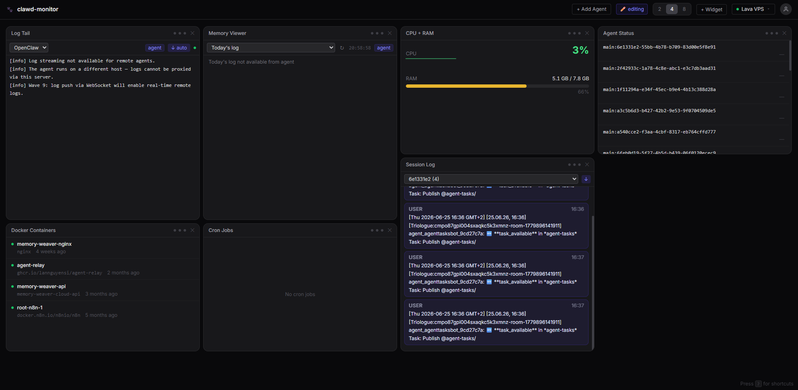

# clawd-monitor

Monitoring dashboard for [OpenClaw](https://openclaw.ai) instances.


## Overview

clawd-monitor is a Next.js dashboard that shows live status for one or more
OpenClaw hosts: sessions, memory files, cron jobs, and Docker containers.
Each host runs the companion
[clawd-monitor-agent](https://github.com/LanNguyenSi/clawd-monitor-agent),
which pushes a snapshot over WebSocket every 5 seconds; no inbound port is
required on the agent host. A widget grid renders the latest snapshot per
agent, with a switcher to move between connected agents.



## Key Features

- Live CPU/RAM, session, and agent-status widgets fed by agent push; the
  server never polls the agent host.
- Connected-agent list with online/offline status and per-agent switching.
- Memory viewer, cron jobs, Docker containers, and log tail widgets.
- GitHub PR widget for open pull requests, and service-health checks for the
  URLs in the `SERVICE_HEALTH_URLS` environment variable (empty means no checks).
- Alert history (from the server's `CLAWD_DIR`) and heartbeat pulse.
- Drag/resize/close widget layout, dark mode, and keyboard shortcuts.

See [docs/widgets.md](docs/widgets.md) for the full widget list and
shortcuts.

## Quick Start

### 1. Run clawd-monitor (server)

Prerequisites: Docker with Compose v2.24 or later (the compose files use
`env_file` entries with `required: false`), and a running Traefik on an
external Docker network named `traefik` with a `websecure` entrypoint, a
`letsencrypt` certificate resolver, and a file-provider TLS options set named
`nohttp2`. The router references `nohttp2@file` to keep the agent WebSocket on
HTTP/1.1. A matching Traefik dynamic configuration:

```yaml
tls:
  options:
    nohttp2:
      alpnProtocols:
        - http/1.1
```

```bash
git clone https://github.com/LanNguyenSi/clawd-monitor
cd clawd-monitor
cp .env.example .env
# edit .env: set ADMIN_PASSWORD, JWT_SECRET, DOMAIN

docker compose -f docker-compose.traefik.yml up -d
```

Secrets can go into `.env.runtime` instead; see
[docs/configuration.md](docs/configuration.md#docker-compose-env-files) for the
`$$` escaping rule. The Docker widget needs the app user in the host's docker
group: set `DOCKER_GID` in `.env` when it is not 988 (root-equivalent access to
the host's Docker daemon, see [docs/configuration.md](docs/configuration.md#docker-socket-access)).

Without Traefik, `make docker-up` (or `docker compose -p clawd-monitor-local -f docker-compose.yml up -d`) serves plain HTTP on port 3000
(create the data volume first: `docker volume create clawd_monitor_data`).
The port is bound to `127.0.0.1` and `docker-compose.yml` sets its own project
name `clawd-monitor-local`, so a bare `docker compose` in this directory acts on
the local stack, whose project name does not match the production project
`clawd-monitor`. This mode is local-only:
the port listens on `127.0.0.1` only, and the session cookie is marked Secure in
production, so browsers on other machines need HTTPS (for example the Traefik
setup above). See
[Troubleshooting](docs/configuration.md#troubleshooting) for this and other
setup problems.

Open `https://your-domain/` (or `http://localhost:3000`) and sign in with the admin password from `.env`.
After the first login, use `Settings` in the UI to change the admin
password, then generate an agent token there too.

### 2. Connect an agent

On each OpenClaw host to monitor:

```bash
npm install -g clawd-monitor-agent
install -m 600 /dev/null ~/.clawd-agent-token   # then put the token from Settings in it
clawd-monitor-agent \
  --server https://your-clawd-monitor-domain \
  --token-file ~/.clawd-agent-token \
  --name "My OpenClaw Host" \
  --gateway http://localhost:18789
```

Keep the token off the command line: a `--token <value>` argument stays
readable in the process list (`ps`, `/proc/<pid>/cmdline`) for as long as
the agent runs, and with it any local user on that host can connect as your
agent. The agent reads the token from `--token-file`, the
`CLAWD_AGENT_TOKEN` environment variable or the `token` key of its config
file, in that order of precedence; `--token` still works for existing
installs but is deprecated and prints a warning.

Or copy the install snippet directly from the Settings page. It runs the
agent's installer with the token in the `CLAWD_AGENT_TOKEN` environment
variable instead of an argument, and the installer stores it in a file
readable only by the service user. The pasted line stays in your shell
history, so clear that entry on a shared host (or see the agent's README
for the variant that prompts for the token). The snippet needs the
installer from `clawd-monitor-agent` master, which reads that variable. An
agent started with `--token` on an earlier version keeps working; see the
[agent README](https://github.com/LanNguyenSi/clawd-monitor-agent#upgrading-an-install-that-uses---token)
to move it to a token file.

## Usage

Agents authenticate with the token issued from Settings and start pushing
snapshots immediately; no server restart is required. Widgets pick up the
new agent as soon as its first snapshot arrives, and the navbar switcher
lets you move between all currently connected agents.

## Documentation

- [docs/widgets.md](docs/widgets.md): widget reference and keyboard
  shortcuts.
- [docs/configuration.md](docs/configuration.md): environment variables, how
  the admin password is resolved, Docker Compose env files, and
  troubleshooting.
- [docs/ARCHITECTURE.md](docs/ARCHITECTURE.md): data paths, key design
  decisions, the [security model](docs/ARCHITECTURE.md#security-model), and
  directory structure.
- [docs/AGENT-PROTOCOL.md](docs/AGENT-PROTOCOL.md): the agent WebSocket
  message format.
- [docs/SPEC-GATEWAY.md](docs/SPEC-GATEWAY.md): the original design spec for
  the agent-push model (historical; the code is authoritative where they
  differ).
- [docs/development.md](docs/development.md): npm scripts and make targets.

## Development and Contributing

```bash
npm install
cp .env.example .env.local
npm run dev
```

See [CONTRIBUTING.md](CONTRIBUTING.md) for the full setup, project
structure, and pull request checklist, and
[docs/development.md](docs/development.md) for the npm scripts and make
targets.

## License

MIT, see [LICENSE](LICENSE).
