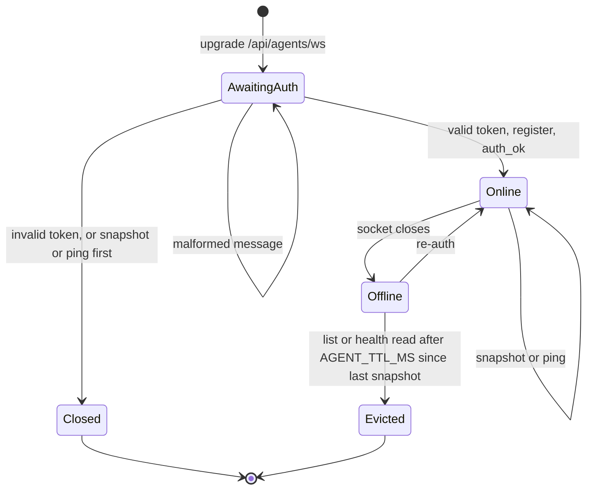

# Agent WebSocket Protocol

This is the authoritative message-format reference for `clawd-monitor-agent`
clients. It documents what the server actually implements in `server.ts`,
`src/lib/agent-ws-handler.ts`, `src/lib/schemas.ts`, and
`src/lib/agent-registry.ts`. The code is the source of truth; if this doc and the
code disagree, the code wins.

## Endpoint

```
ws(s)://<clawd-monitor-host>/api/agents/ws
```

The custom server upgrades only this exact path; any other upgrade request is
destroyed in production (in development it goes to Next for HMR). No user JWT is required — agents authenticate with an agent token.

## Handshake

The first valid message MUST be an `auth` message. A valid `snapshot` or
`ping` sent before authentication is rejected with `auth_error` ("Expected
auth message first") and the socket is closed; malformed messages are handled
as described under [Errors](#errors).

Agent → server:

```json
{
  "type": "auth",
  "token": "<agent-token>",
  "agentId": "<stable-unique-id>",
  "name": "<display-name>",
  "version": "<agent-version>",
  "gatewayUrl": "http://localhost:18789",
  "gatewayToken": "<optional OpenClaw token>"
}
```

- `token`, `agentId`, `name` are required and non-empty; `version` is required.
- `gatewayUrl` and `gatewayToken` are optional. The server accepts any
  `gatewayUrl` here; it fetches it (for the Log Tail widget) only when it is
  `https`, its host is in the server's `ALLOWED_GATEWAY_HOSTS` and it is not a
  private or loopback address, and never follows redirects.
- Token validation: the token is matched against the static `AGENT_TOKENS` env
  list (exact match) first, then against persisted Settings-UI tokens
  (bcrypt-compared; a match updates that token's `lastUsedAt`). An invalid token yields `auth_error` ("Invalid token") and
  the socket is closed.

Server → agent on success:

```json
{ "type": "auth_ok" }
```

If two connections present the same `agentId`, the newest connection wins; the
older socket is left to close on its own.

## Snapshots

After `auth_ok`, the agent pushes snapshots (the reference agent does so roughly
every 5 seconds; cadence is the agent's choice and not enforced by the server).

Agent → server:

```json
{
  "type": "snapshot",
  "data": {
    "agentId": "<id>",
    "name": "<name>",
    "timestamp": 1700000000000,
    "version": "<agent-version>",
    "sessions": [],
    "cronJobs": [],
    "metrics": {
      "cpuPercent": 0,
      "memUsedBytes": 0,
      "memTotalBytes": 0,
      "uptimeSeconds": 0
    },
    "memoryFiles": { "memory": "", "current": "", "today": "", "yesterday": "" },
    "containers": []
  }
}
```

- `metrics` is required with all four numeric fields.
- `sessions`, `cronJobs`, `containers` default to `[]`; `memoryFiles` defaults to
  `{}` and its `memory` / `current` / `today` / `yesterday` fields are each optional strings.

### Element fields the dashboard reads

The server validates only that `sessions`, `cronJobs` and `containers` are
arrays. The widgets read these fields from their elements:

- `sessions[]`: `sessionKey` (string; a session without it makes the Agent
  Status widget throw and show its error state), `model`, `lastMessage`,
  `lastActiveAt` (ISO time), and `recentMessages[]` with `role` (`user` /
  `assistant` / `system`), `content` and `timestamp`.
- `cronJobs[]`: `id`, `name`, `enabled`, `schedule` { `kind` (`cron`, `every`
  or `at`), `expr`, `everyMs` }, `state` { `nextRunAtMs`, `lastRunAtMs` }.
- `containers[]`: `id`, `name`, `image`, `state` (`running` / `exited` /
  `paused` / `restarting` / `unknown`), `restarts` (number, the real restart
  count from `docker inspect`; omitted when the agent could not read it),
  `uptime` (string, the time since the container was created).

An element without these fields passes validation but renders empty.

Server → agent after a valid snapshot:

```json
{ "type": "ack" }
```

## Keepalive

Agent → server:

```json
{ "type": "ping" }
```

Server → agent:

```json
{ "type": "pong" }
```

## Errors

- A message that parses as JSON but fails schema validation gets
  `{ "type": "error", "message": "Invalid message format" }`; the connection
  stays open.
- A payload that is not valid JSON is ignored silently (no reply).

## Offline behavior and TTL

When a socket closes, the agent is marked offline but its last snapshot is
retained. Offline agents are evicted from the in-memory registry once
`Date.now() - lastSnapshotAt` exceeds `AGENT_TTL_MS` (default `300000`, i.e. 5
minutes). Until then, `/api/agents/list` still returns the agent with its last
snapshot and `online: false`.

Eviction is not timer-based: it runs when `/api/agents/list` or `/api/health`
is read, so `/api/agents/<id>/snapshot` can still return an expired entry until
then. An agent that authenticated but never sent a snapshot is evicted on the
first such read after it disconnects. A newer connection with the same
`agentId` replaces the entry, and only the close of the current socket marks
it offline.

The state diagram shows the lifecycle of a connection and its registry entry.



## Reading agent data (browser side, JWT-gated)

- `GET /api/agents/list` — all agents (online and offline-within-TTL), without
  the live socket or secret token/gateway-token fields.
- `GET /api/agents/[agentId]/snapshot` — the latest snapshot for one agent.
