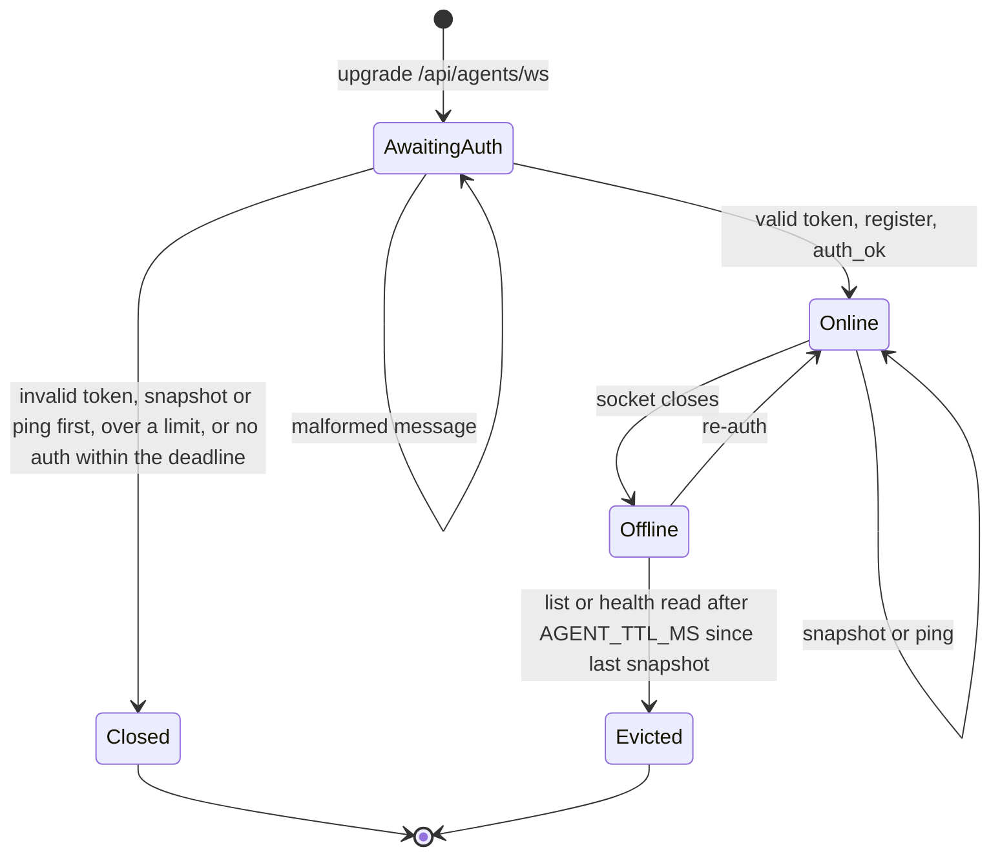

# Agent WebSocket Protocol

This is the authoritative message-format reference for `clawd-monitor-agent`
clients. It documents what the server actually implements in `server.ts`,
`src/lib/agent-ws-handler.ts`, `src/lib/schemas.ts`, and
`src/lib/agent-registry.ts`. The code is the source of truth; if this doc and the
code disagree, the code wins.

## Endpoint

```
ws(s)://<clawd-monitor-host>/api/agents/ws
```

The custom server upgrades only this exact path; any other upgrade request is
destroyed in production (in development it goes to Next for HMR). No user JWT is required — agents authenticate with an agent token.

## Handshake

The first valid message MUST be an `auth` message. A valid `snapshot` or
`ping` sent before authentication is rejected with `auth_error` ("Expected
auth message first") and the socket is closed; malformed messages are handled
as described under [Errors](#errors).

Agent → server:

```json
{
  "type": "auth",
  "token": "<agent-token>",
  "agentId": "<stable-unique-id>",
  "name": "<display-name>",
  "version": "<agent-version>",
  "gatewayUrl": "http://localhost:18789",
  "gatewayToken": "<optional OpenClaw token>"
}
```

- `token`, `agentId`, `name` are required and non-empty; `version` is required.
- `gatewayUrl` and `gatewayToken` are optional. The server accepts any
  `gatewayUrl` here; it fetches it (for the Log Tail widget) only when it is
  `https`, its host and port are in the server's `ALLOWED_GATEWAY_HOSTS` (an
  entry without a port means 443 only) and neither the host nor any address it
  resolves to is private or loopback. The server connects to exactly the
  addresses it checked and never follows redirects. A URL equal to the
  server's default gateway URL gets no exception from this rule. The server
  requests `<gatewayUrl>/logs/stream?source=openclaw`; it never forwards the
  Docker source to an agent's gateway.
- Token validation: the token is matched against the static `AGENT_TOKENS` env
  list (exact match) first, then against persisted Settings-UI tokens
  (bcrypt-compared; a match updates that token's `lastUsedAt`). An invalid token yields `auth_error` ("Invalid token") and
  the socket is closed.
- Token binding: a persisted (Settings-UI) token is bound to one `agentId`. The
  first successful handshake with a token records its `agentId` in
  `tokens.json`; from then on that token is accepted only for that `agentId`.
  A handshake that presents the token with another `agentId` gets the same
  `auth_error` ("Invalid token") and close code 1008 as an invalid token, and
  the existing registry entry of that other agent is not touched; the server
  log names the token and the mismatch, never the token value. Tokens created
  before the binding existed bind on their next handshake. If the binding
  cannot be written (a read-only data directory), the handshake is refused the
  same way and the agent has to retry once the directory is writable. Revoking
  a token removes its binding with it; a new token for the same agent starts
  unbound. Use one token per agent: an agent that shared one persisted token
  across several `agentId`s is refused for all but the first.
- Static tokens are not bound. A token from `AGENT_TOKENS` is shared by design,
  so its holder can connect as any `agentId`, including one bound to a
  persisted token. Keep `AGENT_TOKENS` for a single trusted host or small
  setup and use per-agent tokens from the settings page where hosts should not
  be able to claim each other's identity. Binding is per token and trust on
  first use, not unique per `agentId`: several tokens may bind the same
  `agentId` (needed to rotate a token: create the new one, connect, then revoke
  the old one). A persisted token that has not been used yet can therefore take
  any `agentId`, including one bound to another token and currently online.
  `GET /api/settings/tokens` returns the bound `agentId` of each token (absent
  while unbound) so an operator can check what each token bound to.

Server → agent on success:

```json
{ "type": "auth_ok" }
```

If two connections present the same `agentId` (with a token that is allowed to
use it, see token binding above), the newest connection wins; the
older socket is left to close on its own.

## Snapshots

After `auth_ok`, the agent pushes snapshots (the reference agent does so roughly
every 5 seconds; cadence is the agent's choice and not enforced by the server).

Agent → server:

```json
{
  "type": "snapshot",
  "data": {
    "agentId": "<id>",
    "name": "<name>",
    "timestamp": 1700000000000,
    "version": "<agent-version>",
    "sessions": [],
    "cronJobs": [],
    "metrics": {
      "cpuPercent": 0,
      "memUsedBytes": 0,
      "memTotalBytes": 0,
      "uptimeSeconds": 0
    },
    "memoryFiles": { "memory": "", "current": "", "today": "", "yesterday": "" },
    "containers": []
  }
}
```

- `metrics` is required with all four numeric fields.
- `sessions`, `cronJobs`, `containers` default to `[]`; `memoryFiles` defaults to
  `{}` and its `memory` / `current` / `today` / `yesterday` fields are each optional strings.

### Element fields the dashboard reads

The server validates only that `sessions`, `cronJobs` and `containers` are
arrays. The widgets read these fields from their elements:

- `sessions[]`: `sessionKey` (string; a session without it makes the Agent
  Status widget throw and show its error state), `model`, `lastMessage`,
  `lastActiveAt` (ISO time), and `recentMessages[]` with `role` (`user` /
  `assistant` / `system`), `content` and `timestamp`.
- `cronJobs[]`: `id`, `name`, `enabled`, `schedule` { `kind` (`cron`, `every`
  or `at`), `expr`, `everyMs` }, `state` { `nextRunAtMs`, `lastRunAtMs` }.
- `containers[]`: `id`, `name`, `image`, `state` (`running` / `exited` /
  `paused` / `restarting` / `unknown`), `restarts` (number, the real restart
  count from `docker inspect`; omitted when the agent could not read it),
  `uptime` (string, the time since the container was created).

An element without these fields passes validation but renders empty.

Server → agent after a valid snapshot:

```json
{ "type": "ack" }
```

## Keepalive

Agent → server:

```json
{ "type": "ping" }
```

Server → agent:

```json
{ "type": "pong" }
```

## Errors

- A message that parses as JSON but fails schema validation gets
  `{ "type": "error", "message": "Invalid message format" }`; the connection
  stays open.
- A payload that is not valid JSON is ignored silently (no reply).

## Limits and close codes

The endpoint is open to anyone, so a socket that has not authenticated yet is
held to limits (constants in `src/lib/agent-ws-limits.ts`, not settings). When
one is hit the server closes the socket with a WebSocket close code and sends
no `auth_error`: that message makes the reference agent stop for good, and
these refusals are temporary, so the agent reconnects with its backoff.

| Limit | Value | When it is hit |
| --- | --- | --- |
| Message size before authentication | 8 KiB | Close `1009` (`Message too big`), the message is not parsed |
| Message size at any time | 1 MiB | ws closes the socket with `1009`; the reference agent's largest snapshot is about 360 KiB in the worst case, typically a tenth of that |
| Time to authenticate | 10 s after connecting | Close `1008` (`Authentication timeout`); a socket that authenticated is not affected |
| Sockets waiting to authenticate | 32, all clients together; 4 per client key and 16 per IPv6 /48 | The next socket is closed at once with `1013` (`Server busy`) |
| Persisted-token handshakes per client IP | 10 per 15 minutes | Close `1008` (`Too many attempts`) before the token store is read; a successful handshake clears the IP's count |

- The handshake limit counts only tokens that need the token store and a
  bcrypt compare. A token from `AGENT_TOKENS` is matched first, costs nothing,
  and is never refused or counted for it; a successful persisted-token
  handshake clears the failures of that client.
- The client IP is derived as for the login limit: the TCP peer address, or
  with `TRUSTED_PROXY_HOPS=N` the N-th `X-Forwarded-For` address from the
  right (see `docs/configuration.md`, "Login rate limit"). IPv6 clients count
  by /64 and also against their /48 (50 handshakes).
- Several agents behind one address share that address's handshake count and
  its 4 waiting sockets: when more than 4 agents behind one address connect in
  the same instant, the surplus sees `1013` and succeeds on its backoff retry.
  A waiting socket counts until the work for its messages has finished, which
  includes a token compare still running after the socket closed. Many
  addresses together can still fill the 32 slots; agents then wait and retry.
  State is in memory, so a restart clears it.
- The handshake budget also bounds the CPU one address can spend: up to 10
  handshakes per 15 minutes, each up to one bcrypt compare (about 100 ms) per
  stored token. A socket gets one persisted-token handshake (every
  outcome but success closes it); an `auth` message sent on the same socket
  meanwhile is ignored (the socket stays open and the first handshake decides
  the outcome).
- An invalid token still gets `auth_error` ("Invalid token") and close `1008`,
  as described under [Handshake](#handshake).

## Offline behavior and TTL

When a socket closes, the agent is marked offline but its last snapshot is
retained. Offline agents are evicted from the in-memory registry once
`Date.now() - lastSnapshotAt` exceeds `AGENT_TTL_MS` (default `300000`, i.e. 5
minutes). Until then, `/api/agents/list` still returns the agent with its last
snapshot and `online: false`.

Eviction is not timer-based: it runs when `/api/agents/list` or `/api/health`
is read, so `/api/agents/<id>/snapshot` can still return an expired entry until
then. An agent that authenticated but never sent a snapshot is evicted on the
first such read after it disconnects. A newer connection with the same
`agentId` replaces the entry, and only the close of the current socket marks
it offline.

The state diagram shows the lifecycle of a connection and its registry entry.



## Reading agent data (browser side, JWT-gated)

- `GET /api/agents/list` — all agents (online and offline-within-TTL), without
  the live socket or secret token/gateway-token fields.
- `GET /api/agents/[agentId]/snapshot` — the latest snapshot for one agent.
