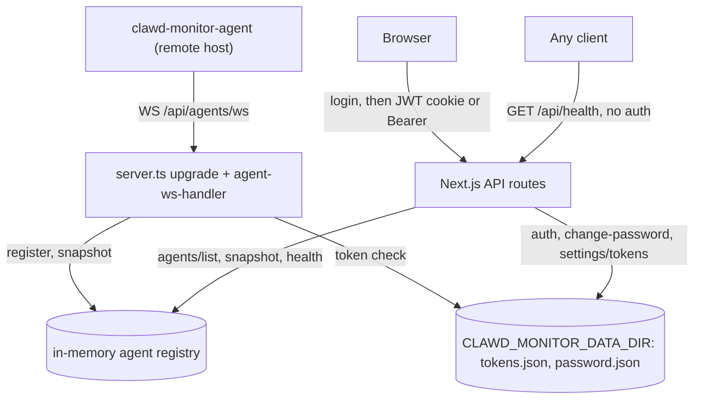
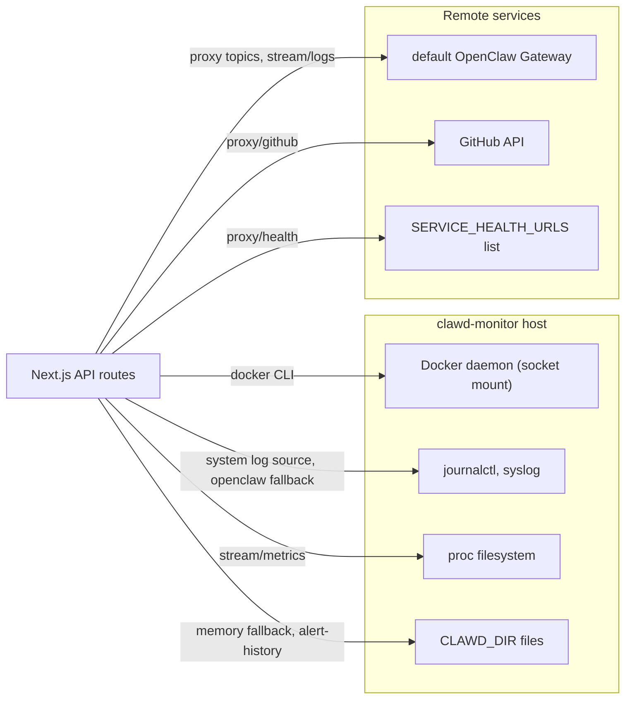

# Architecture: clawd-monitor

## Overview

clawd-monitor runs on a custom Next.js server (`server.ts`) that serves the
dashboard and also accepts agent WebSocket connections. Two data paths coexist:

1. **Agent push (primary):** remote `clawd-monitor-agent` processes connect to
   `/api/agents/ws` and push periodic snapshots. The server keeps them in an
   in-memory registry; widgets read the latest snapshot. No inbound port is
   needed on the agent host.
2. **Server-side routes (no agent selected):** the Gateway topic routes under
   `/api/proxy/*` (`sessions`, `cron`, `heartbeat`, `memory` and the generic
   `[...path]` proxy) and `/api/stream/logs?source=openclaw` call the default
   OpenClaw Gateway (`NEXT_PUBLIC_DEFAULT_GATEWAY_URL`, default
   `http://localhost:9500`). `/api/stream/metrics` reads `/proc` on the
   clawd-monitor host; the docker and system log sources run `docker logs`,
   `journalctl` or `tail` there; `alert-history`, `docker`, `github` and
   `health` under `/api/proxy/*` read server-local or third-party data.

The first diagram shows the agent-push path, the browser-facing API routes, the
persistent data store, and the unauthenticated health endpoint.



The second diagram shows the server-local and outbound data sources of the API
routes.



The agent WebSocket protocol (handshake, snapshot shape, TTL) is documented in
[AGENT-PROTOCOL.md](AGENT-PROTOCOL.md).

## Key Decisions

### ADR-001: No New Backend
Data comes from OpenClaw Gateway API directly. Next.js API routes act as authenticated proxy — they add the Gateway token and forward requests. No new database, no new service.

**Why:** Minimal infrastructure. The Gateway already has everything we need.

**Update (agent-push model):** the direct-proxy path is still supported, but the
primary data path is now agent push over WebSocket. A custom server
(`server.ts`) accepts agent connections and an in-memory registry
(`src/lib/agent-registry.ts`) holds the latest snapshot per agent. This is still
"no new database" — the registry is process-memory only with a TTL.

### ADR-002: SSE over WebSockets for Streaming
Log tailing and metrics use SSE (Server-Sent Events) from Next.js API routes. The route reads from the OpenClaw Gateway (polling or streaming) and pushes to the client.

**Why:** SSE is simpler, works through HTTP/2, no upgrade required. Sufficient for log tailing.

**Update:** `/api/stream/metrics` samples `/proc/stat` and `/proc/meminfo` on
the clawd-monitor host and never contacts a Gateway; with an agent selected,
the CPU + RAM widget reads the agent snapshot instead. `/api/stream/logs`
reaches the Gateway only for `source=openclaw`; its docker and system sources
read the clawd-monitor host. `/api/agents/<id>/logs` never starts a process:
its docker and system sources answer "not available" lines, and the log tail
widget offers only OpenClaw while an agent is selected.

**Update (agent-push model):** browser-facing streaming still uses SSE, but
agent-to-server transport is now a WebSocket (`/api/agents/ws`, handled in
`server.ts` via the `ws` package), because agents push bidirectional,
long-lived snapshot/ping traffic that SSE does not fit.

### ADR-003: react-grid-layout for Widget Grid
Industry standard for React drag-and-drop grids. Supports resize, persist layout as JSON.

**Layout configs:** `{ cols: 2 | 4 | 8, rowHeight: 150 }` — user selects from navbar.

### ADR-004: Multi-Instance via Saved Configs
Instances stored in localStorage as `{ name, gatewayUrl, token }[]`. Switcher in nav selects active instance. All API proxy routes use the active instance config.

**No server-side instance state** — purely client-driven.

**Update:** the instance switcher and `src/lib/instance.ts` were removed in 0.3.0
(the navbar carries the agent switcher instead), and the browser fetcher sends no `x-gateway-url` /
`x-gateway-token` headers. The direct-proxy routes therefore use
`NEXT_PUBLIC_DEFAULT_GATEWAY_URL` and `DEFAULT_GATEWAY_TOKEN` for requests from
the dashboard. To monitor several hosts, connect one agent per host.

### ADR-005: Widget Registry Pattern
Each widget is a self-contained React component that:
1. Declares its metadata (`id`, `title`, `defaultSize`)
2. Fetches its own data via SWR or SSE
3. Renders independently

New widgets = new file in `src/components/widgets/`. No changes to core grid.

**Update:** metadata (id, title, component name, default and minimum size) is
registered centrally in `src/lib/widgets.ts`, and each component must also be
mapped in `WIDGET_COMPONENTS` in `src/components/Grid/WidgetGrid.tsx`.

## Security model

### Admin access

There is one admin password (see
[configuration.md](configuration.md#admin-password-resolution)). Login issues
a JWT valid for 24 hours in an httpOnly, `SameSite=Lax` cookie that is Secure
when `NODE_ENV=production`; an `Authorization: Bearer` header is also
accepted. There is no server-side session store, so logout and a password
change do not revoke an already issued JWT before it expires.

### Unauthenticated endpoints

- `POST /api/auth` (login), `GET /api/auth` (session check) and
  `DELETE /api/auth` (logout, clears the cookie).
- `GET /api/health`: process uptime and the total and online agent counts.
- `/api/agents/ws`: requires an agent token instead of the admin JWT.

All other API routes require the admin JWT.

### Agent tokens

Static `AGENT_TOKENS` are compared in plaintext. Tokens created in Settings
are stored as bcrypt hashes in `tokens.json` (file mode 0600) under
`CLAWD_MONITOR_DATA_DIR`; a successful handshake with one of them stamps its
`lastUsedAt`, shown in Settings. Tokens are checked at connect time only, so revoking
a token stops new connections but does not close an open one (restart the
server to drop it). A token is not bound to an `agentId`: the newest
connection for an `agentId` replaces the registry entry, including its gateway
URL.

### Outbound requests

The server makes requests to the default OpenClaw Gateway, to gateway URLs
reported by agents, to the GitHub API (GitHub PRs widget), and to the fixed
URL list of the Service Health widget.

### Docker socket

`docker-compose.traefik.yml` mounts `/var/run/docker.sock` into the container
so the Docker widget and the docker log source can run the docker CLI. The
`:ro` flag does not limit what the Docker API allows over the socket, so treat
access to this container as access to the host's Docker daemon.

## Directory Structure

```
clawd-monitor/
├── server.ts                  → Custom Next.js server + agent WebSocket upgrade (/api/agents/ws)
├── src/
│   ├── app/
│   │   ├── (auth)/login/      → Login page
│   │   ├── dashboard/         → Main grid page
│   │   ├── settings/          → Settings (admin password, agent tokens)
│   │   ├── api/
│   │   │   ├── auth/route.ts                           → GET/POST/DELETE /api/auth (session, login, logout → JWT)
│   │   │   ├── auth/change-password/route.ts           → POST admin password change
│   │   │   ├── agents/list/route.ts                    → GET connected agents (JWT)
│   │   │   ├── agents/[agentId]/snapshot/route.ts      → GET latest agent snapshot (JWT)
│   │   │   ├── agents/[agentId]/logs/route.ts          → SSE: agent logs (JWT)
│   │   │   ├── agents/[agentId]/route.ts               → DELETE remove an offline agent (JWT)
│   │   │   ├── containers/route.ts                     → GET Docker container list
│   │   │   ├── health/route.ts                         → GET server + registry health
│   │   │   ├── settings/tokens/route.ts                → GET/POST agent tokens
│   │   │   ├── settings/tokens/[id]/route.ts           → DELETE/PATCH agent token by id
│   │   │   ├── proxy/[...path]/route.ts                → GET/POST/PUT/DELETE/PATCH generic proxy to Gateway
│   │   │   ├── proxy/{heartbeat,sessions}/route.ts     → GET Gateway proxy (status, sessions)
│   │   │   ├── proxy/cron/route.ts                     → GET Gateway proxy (cron jobs, read-only)
│   │   │   ├── proxy/memory/route.ts                   → GET Gateway proxy with CLAWD_DIR filesystem fallback
│   │   │   ├── proxy/{alert-history,docker,github,health}/route.ts → GET server-local / third-party data, not Gateway
│   │   │   ├── stream/logs/route.ts                    → SSE: logs (openclaw: Gateway with local journal fallback; docker/system: this host)
│   │   │   └── stream/metrics/route.ts                 → SSE: CPU/RAM of this host from /proc
│   │   └── layout.tsx
│   ├── components/
│   │   ├── Grid/              → WidgetGrid, GridItem
│   │   └── widgets/
│   │       ├── LogTailWidget.tsx
│   │       ├── MetricsWidget.tsx
│   │       ├── MemoryWidget.tsx
│   │       ├── AgentStatusWidget.tsx
│   │       ├── AgentListWidget.tsx
│   │       ├── CronWidget.tsx
│   │       ├── DockerWidget.tsx
│   │       └── ...
│   ├── lib/
│   │   ├── auth.ts            → JWT sign/verify
│   │   ├── gateway.ts         → Gateway API client (SSRF-guarded)
│   │   ├── agent-registry.ts  → In-memory connected-agent registry
│   │   ├── agent-ws-handler.ts → Agent WebSocket auth + snapshot handler
│   │   ├── schemas.ts         → Zod schemas for agent messages/snapshots
│   │   ├── env-bootstrap.ts   → Loads .env / .env.local before other modules read the environment
│   │   ├── ws-upgrade.ts      → WebSocket upgrade handling for the custom server
│   │   ├── data-store.ts      → tokens.json / password.json in CLAWD_MONITOR_DATA_DIR
│   │   ├── fetcher.ts         → Browser fetch helper for the dashboard
│   │   ├── ...                → further helpers (not every file is listed)
│   │   └── widgets.ts         → Widget registry
│   └── types/
│       └── index.ts           → Shared types
├── Dockerfile
├── docker-compose.traefik.yml
└── .env.example
```

## Stack

- [Next.js 15](https://nextjs.org): App Router plus the custom WebSocket
  server (`server.ts`).
- [TypeScript](https://www.typescriptlang.org) in strict mode.
- [Tailwind CSS](https://tailwindcss.com) with dark mode.
- [react-grid-layout](https://github.com/react-grid-layout/react-grid-layout)
  for the drag-and-drop widget grid.
- [SWR](https://swr.vercel.app) for client-side data fetching.
- Docker and Traefik for deployment.

## Environment Variables

See [configuration.md](configuration.md) for the full list of environment
variables the server reads and how the admin password is resolved.

## Deployment

Docker + Traefik; see the README Quick Start for the Compose and Traefik
prerequisites (including the `nohttp2` TLS options set) and
[configuration.md](configuration.md) (`DOMAIN`, Docker Compose env files).

Dockerfile: multi-stage (deps → builder → runner), `node:22-slim`.
