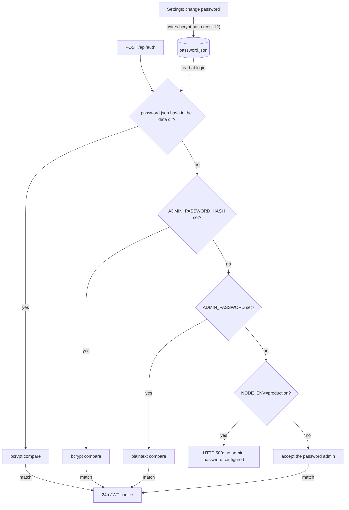

# Configuration

Environment variables read by the server (`server.ts` and the Next.js API
routes). See `.env.example` for a copyable template.

```env
# Required (enforced only when NODE_ENV=production; development falls back to insecure defaults)
ADMIN_PASSWORD=             # plaintext, or use ADMIN_PASSWORD_HASH (bcrypt)
JWT_SECRET=                 # random 32+ char string

# Optional
AGENT_TOKENS=token1,token2  # static tokens (also manageable via Settings UI)
AGENT_TTL_MS=300000         # offline-agent TTL in ms (default 5min)
NEXT_PUBLIC_DEFAULT_GATEWAY_URL=http://localhost:9500
DEFAULT_GATEWAY_TOKEN=      # default OpenClaw API token
ALLOWED_GATEWAY_HOSTS=      # SSRF allowlist for per-instance gateway overrides (comma-separated hostnames)
CLAWD_DIR=/root/.openclaw/workspace  # server-local OpenClaw workspace: Memory Viewer fallback (MEMORY.md / CURRENT.md / memory/*.md) and Alert History source (memory/smart-alert-state.json); code default when unset is /root/clawd
CLAWD_MONITOR_DATA_DIR=/data   # persistent storage for tokens + password hash
DOMAIN=monitor.yourdomain.com  # read by docker-compose.traefik.yml only, not by the server
GITHUB_TOKEN=               # GitHub API token for the GitHub PRs widget; the repository list is the default in src/app/api/proxy/github/route.ts
PORT=3000                   # listen port (server.ts default)
HOSTNAME=0.0.0.0            # listen address (server.ts default)
```

When running outside Docker (`npm run dev`, `npm start`), set `AGENT_TOKENS`,
`AGENT_TTL_MS` and `CLAWD_MONITOR_DATA_DIR` in the shell environment, and for
`npm start` also `JWT_SECRET` and `ADMIN_PASSWORD` or `ADMIN_PASSWORD_HASH`.
The custom server reads these before Next.js loads `.env` / `.env.local`;
values only in those files reach the API routes but not the agent WebSocket
handler or the production startup check. Under Docker Compose all values come
from the process environment.

Notes:

- `ADMIN_PASSWORD` is compared as plaintext. Set `ADMIN_PASSWORD_HASH` instead
  (a bcrypt hash) if you prefer not to store the plaintext password in the
  environment; use the matching plaintext password to log in. Generate the
  hash in the repository after `npm install`:
  `node -e "require('bcryptjs').hash('yourpassword',10).then(console.log)"`.
  In files read by Docker Compose, write each `$` of the hash as `$$` (see
  [Docker Compose env files](#docker-compose-env-files)).
- After the first login, use `Settings` in the UI to change the admin
  password; that change is persisted in `CLAWD_MONITOR_DATA_DIR` and becomes
  the active login password (it takes precedence over the env var on
  subsequent logins).
- `ALLOWED_GATEWAY_HOSTS` overrides must be `https` and may not point at
  private or loopback IPs; leave it empty to forbid all per-instance
  overrides and use only the default gateway.
- Agent tokens can also be issued and revoked from the Settings UI instead of
  the static `AGENT_TOKENS` list.

## Admin password resolution

Login (`POST /api/auth`) checks one source, in this order, and uses the first
one that is set:

1. The bcrypt hash in `password.json` under `CLAWD_MONITOR_DATA_DIR`, written
   when the password is changed in Settings (bcrypt cost 12).
2. `ADMIN_PASSWORD_HASH` (bcrypt compare). If both env vars are set, the hash
   wins.
3. `ADMIN_PASSWORD` (plaintext compare).
4. None set: login returns HTTP 500 when `NODE_ENV=production`; in development
   the password `admin` is accepted.

A successful login sets a session cookie holding a JWT that is valid for 24
hours. The flowchart shows the same order and where a Settings change is
stored.



## Docker Compose env files

- Both compose files read `.env` and then `.env.runtime`; both are optional.
  `.env.runtime` (template `.env.runtime.example`, gitignored) is the place
  for secrets such as `ADMIN_PASSWORD_HASH` and `JWT_SECRET`. `.env` is also
  used for `${DOMAIN}` in `docker-compose.traefik.yml`.
- In these files, write every `$` in a value as `$$`. A bcrypt hash contains
  `$` characters (example in `.env.runtime.example`).
- `NODE_ENV` and `CLAWD_MONITOR_DATA_DIR` are fixed in the compose files
  (`production`, `/data`) and cannot be changed from the env files.

## Troubleshooting

- **Login does not stick:** the session cookie is marked Secure when
  `NODE_ENV=production`, so over plain HTTP it works only on `localhost`. Use
  HTTPS (for example the Traefik setup in the README) for access from other
  machines.
- **Lost admin password:** delete `password.json` from the data directory
  (`CLAWD_MONITOR_DATA_DIR`, the data volume under Docker Compose); the env
  password applies again on the next login.
- **Docker widget or docker log source empty without an agent:** only
  `docker-compose.traefik.yml` mounts the Docker socket; `docker-compose.yml`
  does not.
- **Switching compose files:** `docker-compose.yml` uses the external volume
  `clawd_monitor_data`, while `docker-compose.traefik.yml` creates a
  project-scoped volume, so tokens and the stored password do not carry over.
