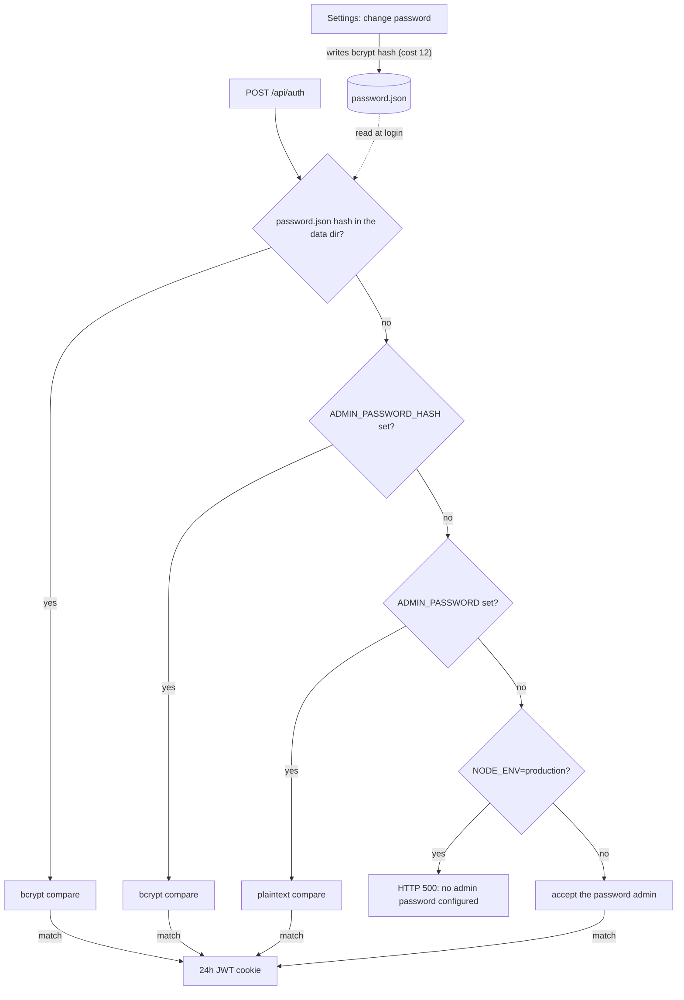

# Configuration

Environment variables read by the server (`server.ts` and the Next.js API
routes). See `.env.example` for a copyable template.

```env
# Required (enforced only when NODE_ENV=production; development falls back to insecure defaults)
ADMIN_PASSWORD=             # plaintext, or use ADMIN_PASSWORD_HASH (bcrypt)
JWT_SECRET=                 # random 32+ char string

# Optional
AGENT_TOKENS=token1,token2  # static tokens (also manageable via Settings UI)
AGENT_TTL_MS=300000         # offline-agent TTL in ms (default 5min)
NEXT_PUBLIC_DEFAULT_GATEWAY_URL=http://localhost:9500
DEFAULT_GATEWAY_TOKEN=      # default OpenClaw API token
ALLOWED_GATEWAY_HOSTS=      # SSRF allowlist for per-instance gateway overrides (comma-separated hostnames)
CLAWD_DIR=/root/.openclaw/workspace  # server-local OpenClaw workspace: Memory Viewer fallback (MEMORY.md / CURRENT.md / memory/*.md) and Alert History source (memory/smart-alert-state.json); code default when unset is /root/clawd
CLAWD_MONITOR_DATA_DIR=/data   # persistent storage for tokens + password hash
DOMAIN=monitor.yourdomain.com  # read by docker-compose.traefik.yml only, not by the server
GITHUB_TOKEN=               # GitHub API token for the GitHub PRs widget (read-only; repo/PR and checks read scope)
GITHUB_REPOS=owner/repo,owner/other  # repositories the GitHub PRs widget lists; empty means the widget shows a hint
SERVICE_HEALTH_URLS=api=https://api.example.com/health,https://example.com  # Service Health widget targets, comma-separated `[name=]url`; empty means no checks
PORT=3000                   # listen port (server.ts default)
HOSTNAME=0.0.0.0            # listen address (server.ts default)
```

When running outside Docker (`npm run dev`, `npm start`), the custom server
loads `.env` and `.env.local` (and the mode-specific variants Next.js knows)
into the process environment before it reads any configuration, so a value
set only in `.env.local` reaches the agent WebSocket handler, the token
routes and the production startup check. A variable that is already in the
process environment (the shell, or Docker Compose) keeps its value over
these files. One caveat: when a key is set in both the process environment
and a `.env` file, the process value is kept, but `@next/env` expands a `$`
in it (`dotenv-expand`), so `pa$word` becomes `pa`. Escape it as `\$` or set
the key in one place only. For `NODE_ENV=production npm start` set
`JWT_SECRET` and
`ADMIN_PASSWORD` or `ADMIN_PASSWORD_HASH`. `npm start` does not set
`NODE_ENV`; without `NODE_ENV=production` the server skips the startup check
and accepts the development fallbacks.

Notes:

- `ADMIN_PASSWORD` is compared as plaintext. Set `ADMIN_PASSWORD_HASH` instead
  (a bcrypt hash) if you prefer not to store the plaintext password in the
  environment; use the matching plaintext password to log in. Generate the
  hash in the repository after `npm install`:
  `node -e "require('bcryptjs').hash('yourpassword',10).then(console.log)"`.
  In files read by Docker Compose, write each `$` of the hash as `$$` (see
  [Docker Compose env files](#docker-compose-env-files)).
- After the first login, use `Settings` in the UI to change the admin
  password; that change is persisted in `CLAWD_MONITOR_DATA_DIR` and becomes
  the active login password (it takes precedence over the env var on
  subsequent logins).
- `ALLOWED_GATEWAY_HOSTS` overrides must be `https` and may not point at
  private or loopback IPs; leave it empty to forbid all per-instance
  overrides and use only the default gateway. The same rule applies to the
  `gatewayUrl` a connected agent reports: the Log Tail widget fetches it only
  when it is `https`, its host is in the list and it is not a private or
  loopback address, otherwise it shows that log streaming is not available.
  That includes a URL equal to the default gateway URL: the default's
  exemption does not apply to agent-reported URLs.
- `GITHUB_TOKEN` and `GITHUB_REPOS` are read from the server environment only;
  the GitHub PRs route ignores a `token` or `repos` query parameter.
- Agent tokens can also be issued and revoked from the Settings UI instead of
  the static `AGENT_TOKENS` list.

## Admin password resolution

Login (`POST /api/auth`) checks one source, in this order, and uses the first
one that is set:

1. The bcrypt hash in `password.json` under `CLAWD_MONITOR_DATA_DIR`, written
   when the password is changed in Settings (bcrypt cost 12).
2. `ADMIN_PASSWORD_HASH` (bcrypt compare). If both env vars are set, the hash
   wins.
3. `ADMIN_PASSWORD` (plaintext compare).
4. None set: login returns HTTP 500 when `NODE_ENV=production`; in development
   the password `admin` is accepted.

A successful login sets a session cookie holding a JWT that is valid for 24
hours. The flowchart shows the same order and where a Settings change is
stored.



## Docker Compose env files

- Both compose files read `.env` and then `.env.runtime`; both are optional.
  `.env.runtime` (template `.env.runtime.example`, gitignored) is the place
  for secrets such as `ADMIN_PASSWORD_HASH` and `JWT_SECRET`. `.env` is also
  used for `${DOMAIN}` in `docker-compose.traefik.yml`.
- In these files, write every `$` in a value as `$$`. A bcrypt hash contains
  `$` characters (example in `.env.runtime.example`).
- `NODE_ENV` and `CLAWD_MONITOR_DATA_DIR` are fixed in the compose files
  (`production`, `/data`) and cannot be changed from the env files.

## Troubleshooting

- **Login does not stick:** the session cookie is marked Secure when
  `NODE_ENV=production`, so over plain HTTP it works only on `localhost`. Use
  HTTPS (for example the Traefik setup in the README) for access from other
  machines.
- **Lost admin password:** delete `password.json` from the data directory
  (`CLAWD_MONITOR_DATA_DIR`, the data volume under Docker Compose); the env
  password applies again on the next login.
- **Docker widget or docker log source empty without an agent:** only
  `docker-compose.traefik.yml` mounts the Docker socket; `docker-compose.yml`
  does not.
- **Switching compose files:** `docker-compose.yml` uses the external volume
  `clawd_monitor_data`, while `docker-compose.traefik.yml` creates a
  project-scoped volume, so tokens and the stored password do not carry over.
  The two declarations differ on purpose and are not aligned: changing the
  volume of an existing deployment points the container at an empty volume,
  so it needs a data migration (copy the contents of the old volume into the
  new one) planned first.
