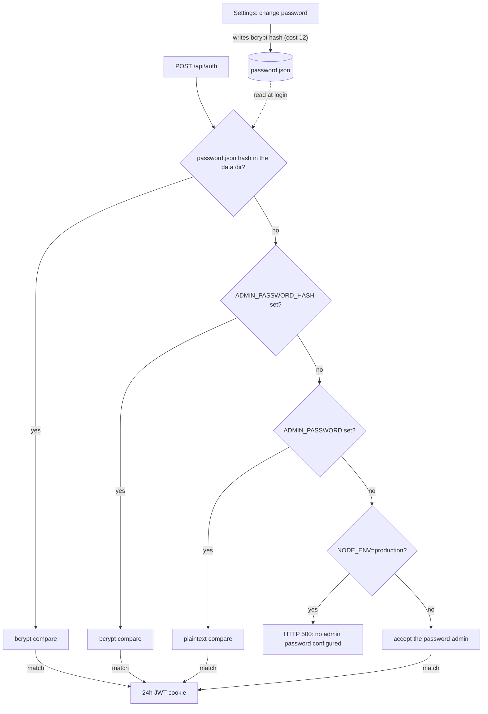

# Configuration

Environment variables read by the server (`server.ts` and the Next.js API
routes). See `.env.example` for a copyable template.

```env
# Required (enforced only when NODE_ENV=production; development falls back to insecure defaults)
ADMIN_PASSWORD=             # plaintext, or use ADMIN_PASSWORD_HASH (bcrypt)
JWT_SECRET=                 # random 32+ char string

# Optional
AGENT_TOKENS=token1,token2  # static tokens (also manageable via Settings UI)
AGENT_TTL_MS=300000         # offline-agent TTL in ms (default 5min)
NEXT_PUBLIC_DEFAULT_GATEWAY_URL=http://localhost:9500
DEFAULT_GATEWAY_TOKEN=      # default OpenClaw API token
ALLOWED_GATEWAY_HOSTS=      # SSRF allowlist for gateway URLs that are not the operator default: agent-reported gatewayUrl and the x-gateway-url header (comma-separated hostnames, each optionally host:port)
CLAWD_DIR=/root/.openclaw/workspace  # path as seen by the server process, not mounted by the Docker compose files (see "CLAWD_DIR under Docker"); server-local OpenClaw workspace: Memory Viewer fallback (MEMORY.md / CURRENT.md / memory/*.md) and Alert History source (memory/smart-alert-state.json); code default when unset is /root/clawd
CLAWD_MONITOR_DATA_DIR=/data   # persistent storage for tokens + password hash
DOMAIN=monitor.yourdomain.com  # read by docker-compose.traefik.yml only, not by the server
GITHUB_TOKEN=               # GitHub API token for the GitHub PRs widget (read-only; repo/PR and checks read scope)
GITHUB_REPOS=owner/repo,owner/other  # repositories the GitHub PRs widget lists; empty means the widget shows a hint
SERVICE_HEALTH_URLS=api=https://api.example.com/health,https://example.com  # Service Health widget targets, comma-separated `[name=]url`; empty means no checks
PORT=3000                   # listen port (server.ts default)
HOSTNAME=0.0.0.0            # listen address (server.ts default)
```

When running outside Docker (`npm run dev`, `npm start`), the custom server
loads `.env` and `.env.local` (and the mode-specific variants Next.js knows)
into the process environment before it reads any configuration, so a value
set only in `.env.local` reaches the agent WebSocket handler, the token
routes and the production startup check. A variable that is already in the
process environment (the shell, or Docker Compose) keeps its value over
these files. One caveat: when a key is set in both the process environment
and a `.env` file, the process value is kept, but `@next/env` expands a `$`
in it (`dotenv-expand`), so `pa$word` becomes `pa`. Escape it as `\$` or set
the key in one place only. For `NODE_ENV=production npm start` set
`JWT_SECRET` and
`ADMIN_PASSWORD` or `ADMIN_PASSWORD_HASH`. `npm start` does not set
`NODE_ENV`; without `NODE_ENV=production` the server skips the startup check
and accepts the development fallbacks.

Notes:

- `ADMIN_PASSWORD` is compared as plaintext. Set `ADMIN_PASSWORD_HASH` instead
  (a bcrypt hash) if you prefer not to store the plaintext password in the
  environment; use the matching plaintext password to log in. Generate the
  hash in the repository after `npm install`:
  `node -e "require('bcryptjs').hash('yourpassword',10).then(console.log)"`.
  In files read by Docker Compose, write each `$` of the hash as `$$` (see
  [Docker Compose env files](#docker-compose-env-files)).
- After the first login, use `Settings` in the UI to change the admin
  password; that change is persisted in `CLAWD_MONITOR_DATA_DIR` and becomes
  the active login password (it takes precedence over the env var on
  subsequent logins).
- `ALLOWED_GATEWAY_HOSTS` entries cover gateway URLs other than the operator
  default: the `gatewayUrl` a connected agent reports and the `x-gateway-url`
  request header (the dashboard's browser code no longer sends it). Such URLs
  must be `https` and may not point at private or loopback IPs; leave it empty
  to forbid all of them and use only the default gateway. Rules for such a
  URL:
  - **Port.** An entry is a host name, optionally followed by `:port`
    (`gw.example.com:8443`; IPv6 as `[2606:4700::1111]:8443`). An entry without
    a port allows port 443 only. An entry with a port allows only that port, so
    a gateway on 443 and one on 8443 need two entries. A request to any other
    port of an allowlisted host is rejected, and an entry with a port that is
    not 1-65535 is ignored. Write an entry in the serialised form of the host
    that appears in the URL (case is ignored): punycode for international
    names and compressed lower-case IPv6 (`[2606:4700::1111]`, not
    `[2606:4700:0:0:0:0:0:1111]`); an entry in another spelling never matches.
  - **Resolved address.** The host name is resolved when the request connects.
    If any address it resolves to is not public, the request is rejected.
    Not public are loopback, private, link-local, carrier-grade NAT
    (`100.64.0.0/10`), unspecified, multicast, reserved, benchmarking
    (`198.18.0.0/15`), documentation (`192.0.2.0/24`, `198.51.100.0/24`,
    `203.0.113.0/24`) and 6to4 relay (`192.88.99.0/24`) IPv4 addresses; every
    IPv6 address outside the global unicast range `2000::/3` (so the
    IPv4-compatible range `::/96` is never public); and inside it all of
    `2001::/23` except the globally reachable blocks `2001:1::1` to
    `2001:1::3`, `2001:3::/32`, `2001:4:112::/48`, `2001:20::/28` and
    `2001:30::/28`, plus documentation (`2001:db8::/32`, `3fff::/20`). An IPv6
    address that carries an IPv4 address (IPv4-mapped, NAT64 `64:ff9b::/96`
    and 6to4 `2002::/16`) is judged by that IPv4 address. The
    connection goes to exactly the addresses that were checked, so a DNS answer
    that changes between the check and the connect has no effect. TLS still
    verifies the certificate against the host name. A redirect answer is never
    followed. An allowlisted name that points at a private address (an
    internal gateway reached by name, for example) no longer works.
  - **Time limits.** For an override, connecting (lookup, TCP and TLS) must
    finish within 10 seconds and the response headers must arrive within 300
    seconds of sending the request; otherwise the request fails. While the
    body is being read, the gateway must not stay silent for more than 300
    seconds, or the read fails. When nobody reads the body and its buffer is
    full, the limit pauses, so a route that does not read a non-OK answer
    cancels its body, which releases the connection at once.
  - **Agent-reported URLs.** The same rule applies to the `gatewayUrl` a
    connected agent reports: the Log Tail widget fetches it only when it is
    `https`, its host and port are in the list and it resolves to public
    addresses, otherwise it shows that log streaming is not available. That
    includes a URL equal to the default gateway URL: the default's exemption
    does not apply to agent-reported URLs.
  The operator default (`NEXT_PUBLIC_DEFAULT_GATEWAY_URL`) is trusted as
  configured, including `http` and a loopback address.
- With an agent selected, the Log Tail widget's Docker source is not
  available: `/api/agents/<id>/logs?source=docker` answers two "not
  available" lines and never starts `docker` on the clawd-monitor host. Clear
  the agent selection to tail containers on the clawd-monitor host. The log
  routes accept only the sources `openclaw`, `docker` and `system` (otherwise
  400).
- `GITHUB_TOKEN` and `GITHUB_REPOS` are read from the server environment only;
  the GitHub PRs route ignores a `token` or `repos` query parameter.
- Agent tokens can also be issued and revoked from the Settings UI instead of
  the static `AGENT_TOKENS` list.

## Admin password resolution

Login (`POST /api/auth`) checks one source, in this order, and uses the first
one that is set:

1. The bcrypt hash in `password.json` under `CLAWD_MONITOR_DATA_DIR`, written
   when the password is changed in Settings (bcrypt cost 12).
2. `ADMIN_PASSWORD_HASH` (bcrypt compare). If both env vars are set, the hash
   wins.
3. `ADMIN_PASSWORD` (plaintext compare).
4. None set: login returns HTTP 500 when `NODE_ENV=production`; in development
   the password `admin` is accepted.

A successful login sets a session cookie holding a JWT that is valid for 24
hours. The flowchart shows the same order and where a Settings change is
stored.



## Docker Compose env files

- Both compose files read `.env` and then `.env.runtime`; both are optional.
  `.env.runtime` (template `.env.runtime.example`, gitignored) is the place
  for secrets such as `ADMIN_PASSWORD_HASH` and `JWT_SECRET`. `.env` is also
  used for `${DOMAIN}` in `docker-compose.traefik.yml`.
- In these files, write every `$` in a value as `$$`. A bcrypt hash contains
  `$` characters (example in `.env.runtime.example`).
- `NODE_ENV` and `CLAWD_MONITOR_DATA_DIR` are fixed in the compose files
  (`production`, `/data`) and cannot be changed from the env files.

## Container health, memory limit and logs

Both compose files give the `app` service the same three settings.

**Healthcheck.** Every 30 s Docker runs a `node -e` fetch of
`http://127.0.0.1:$PORT/api/health` inside the container (`PORT` is 3000 from
the Dockerfile). The check passes on a 2xx answer and fails on any other
status, a refused connection, or no answer within 4 s (the fetch aborts itself
before Docker's 5 s timeout). `GET /api/health` needs no login and returns
`{"status":"ok","uptime":...,"agents":{...}}`. The check uses `node` because the
image always has it; it does not depend on `curl` being in the image. Three
failed checks in a row mark the container `unhealthy`; failures during the 20 s
`start_period` do not count. A cold start measured 0.3 to 0.8 s from container
start to the "ready" log line and the first healthy status came 6 s after
`up -d` on a development machine, so 20 s leaves room for a slow host.

- **Nothing restarts an unhealthy container.** `restart: unless-stopped` acts
  on process exit only, and neither Docker nor Compose restarts a container
  because its healthcheck fails. Measured with the process frozen
  (`SIGSTOP`): `unhealthy` after about 100 s (three failed checks, 30 s apart),
  `RestartCount` stayed 0 and `docker ps` showed `Up ... (unhealthy)`. Find it
  with `docker ps --filter health=unhealthy` and restart it with
  `docker restart <container>`.
- **Traefik stops routing to it.** Traefik's Docker provider skips a container
  whose health status is not `healthy` (and one that is still `starting`),
  unless the provider is configured with `allowEmptyServices`: the log message
  is "Filtering unhealthy or starting container" in `pkg/provider/docker/config.go`
  of [traefik/traefik](https://github.com/traefik/traefik) (read on `master`;
  check it against the Traefik version on the server). The router then
  disappears, so requests for the host get Traefik's 404 instead of hanging,
  and after a deploy the app receives traffic only once its first check has
  passed.

**Memory limit.** `mem_limit: 512m`. In the limited container Node 20 sizes its
heap from the cgroup limit: `v8.getHeapStatistics().heap_size_limit` was
259 MiB, so a runaway JavaScript heap should end in Node's own out-of-memory abort (and
the restart policy) before the kernel kills the container; memory outside the
heap (buffers, native code) is not covered by that margin. An idle container used
about 58 MiB. Before the first deploy with this limit, compare `docker stats` of
the running production container with 512m: a container that already sits near
the limit under real agent load needs a higher `mem_limit` first. Swap is not
capped: without `memswap_limit` Docker allows as much swap as the memory limit
on a host that has swap, so the container can use about 512m of RAM plus 512m
of swap before the kernel kills it.

**Logs.** The `json-file` driver keeps at most 3 files of 10 MB per container
(30 MB). Compose recreates the container on the first `up -d` after this
setting arrived, which discards the old unrotated log of the previous
container.

**Make targets.** `make docker-up` and `make docker-down` run
`docker compose -p clawd-monitor-local -f docker-compose.yml ...`: the plain
HTTP stack under its own project name. A bare `docker compose down` (what the
targets used to run) selects containers by project name (default: the
directory name) and service name, and the production `app` service in
`docker-compose.traefik.yml` has the same service name, so on the server it
would stop the production container. The targets are for local use and never
touch the Traefik stack.

## Hard rebuild (base image or dependency updates)

A normal deploy builds the image of the pulled commit with the Docker build
cache, which reuses every unchanged layer (including the base image layers
already on the server). That is what you want day to day, and `.relay.yml` has
no build hook: agent-relay runs `pre_update` against the pre-pull tree, so a
build there would compile the old commit, and the relay builds the pulled
commit again right after the pull anyway.

For a base-image security update, or when you suspect a stale cached layer,
run a hard rebuild on the server, in the app directory, after a deploy has
finished:

```bash
docker compose -f docker-compose.traefik.yml build --pull --no-cache
docker compose -f docker-compose.traefik.yml up -d
```

`--pull` refreshes the base image, `--no-cache` rebuilds every layer, and the
second command starts the new image. This is a manual maintenance step, not
part of the relay flow, and it costs a full uncached build (minutes, not
seconds).

## CLAWD_DIR under Docker

`CLAWD_DIR` is read by the Alert History route (`memory/smart-alert-state.json`,
`src/app/api/proxy/alert-history/route.ts`) and by the Memory Viewer's
filesystem fallback (`src/app/api/proxy/memory/route.ts`). It is a path as seen
by the clawd-monitor process. Neither `docker-compose.yml` nor
`docker-compose.traefik.yml` mounts any such directory, so inside the
container the path does not exist: Alert History answers "No alert history
yet" and the Memory Viewer fallback answers 404 (the viewer still works
through a gateway or a connected agent). A host path such as
`/root/.openclaw/workspace` in `.env` does not help under Docker: it names a
path inside the container, and the container user (UID 1001, `Dockerfile`)
could not read `/root` anyway.

To use these two features in Docker, add a read-only bind mount of the
workspace to the service in your compose file and point `CLAWD_DIR` at the
container path. Add the two entries to the service's existing `volumes:` and
`environment:` lists (or put them in a compose override file) instead of
pasting a second key. The directory and its files must be readable by UID 1001
(world-readable, or owned by or group-readable for 1001):

```yaml
    volumes:
      - /srv/openclaw/workspace:/openclaw:ro   # host path is an example
    environment:
      - CLAWD_DIR=/openclaw
```

The shipped compose files are not changed for this; the mount is an
operator-side addition.

## Data volume ownership

The app runs as UID 1001 (`nextjs`, `Dockerfile`), and the data directory
`/data` must be writable by that user: the server writes `tokens.json` and
`password.json` into it. The directory itself has to be writable, not only the
files in it: creating a file and replacing one by renaming a temporary file
both need write access to the directory.

- **Fresh volume: nothing to do.** The image contains `/data`, owned by
  `nextjs:nodejs` (UID 1001), created before `USER nextjs`. Docker copies the
  ownership of an image directory into a named volume that is still empty when
  it is mounted, so a new volume (the one `docker compose up` creates for
  `docker-compose.traefik.yml`, or one made with `docker volume create
  clawd_monitor_data` for `docker-compose.yml`) starts as `1001`, and so does an
  empty volume left over from the previous image. The previous image did not
  contain `/data`, so a new volume started as `root` and creating a token or
  changing the password answered 500.
- **Volume that already holds files: the image change does not help.** Docker
  copies the ownership only into an empty volume; a volume with files in it
  keeps its owner (`root:root`, or whatever an operator set). A bind mount on
  `/data` is never adjusted: the host directory must belong to `1001`. Check
  the owner, and fix it once if it is not `1001`:

```bash
VOL=clawd-monitor_clawd_monitor_data   # check with: docker volume ls
docker run --rm -v "$VOL":/data alpine ls -ldn /data
# one-time fix for a volume owned by root: directory and files to the app user
docker run --rm -v "$VOL":/data alpine chown -R 1001:1001 /data
```

  `1001:1001` is the owner and group the image gives `/data` (`nextjs:nodejs`);
  only the owner matters for the app, files it writes carry group `65534`.
- While the owner is wrong, creating a token or changing the password answers
  500; check the owner with the `ls -ldn` command above.

## Docker socket access

Only `docker-compose.traefik.yml` mounts `/var/run/docker.sock` (read-only), for
the Docker widget (`/api/containers`) and the docker log source. On the host the
socket is `root:<docker group>` with mode `0660`, and the app user (UID 1001, no
supplementary groups) could not open it: the widget stayed empty with the answer
`docker not available`. The service therefore has

```yaml
    group_add:
      - "${DOCKER_GID:-988}"
```

which makes the container process a member of the host's docker group. `988` is
only the default (the docker group id on the host this was written for); on
any other host set `DOCKER_GID` to the
group id of the socket in `.env` (compose reads `.env` from the project
directory for the substitution, and a value in the shell wins over `.env`; an
empty `DOCKER_GID=` also falls back to 988):

```bash
stat -c %g /var/run/docker.sock       # Linux: the group id, for example 988
echo 'DOCKER_GID=988' >> .env         # only if it differs from 988
docker compose -f docker-compose.traefik.yml up -d   # recreates the container
docker compose -f docker-compose.traefik.yml exec app id   # groups= lists it
```

The value must be a numeric group id. A wrong number changes nothing visible:
the process holds a group that does not own the socket, `docker ps` inside the
container is denied and `/api/containers` answers
`{"containers":[],"error":"docker not available"}`. A group name (for example
`DOCKER_GID=docker`) or a value with a trailing space makes the container fail
to start (`Unable to find group docker`), because the image has no such group.

**Security: this is root-equivalent access to the host.** Anyone who can use
the Docker API can start a privileged container with the host filesystem
mounted. Membership in the socket's group gives the clawd-monitor process,
and anything that compromises it, exactly that. The `:ro` on the mount only
makes the socket file read-only; it does not restrict the API calls sent over
it, so it is not a protection. The app itself only runs `docker ps`,
`docker inspect` and `docker logs` (no start, stop or exec), but with the access
anyone logged in to the dashboard can list every container on the host and read
its logs, including secrets other containers print. The Docker widget and docker log source need
the access, so the setting is shipped, and the operator decides: to run
without it, remove the `group_add` entry (or the socket mount) from
`docker-compose.traefik.yml`; the widget then stays empty, as the troubleshooting
entry below describes.

## Backup and restore of the data volume

Everything the server persists lives in `CLAWD_MONITOR_DATA_DIR`
(`/data` in both compose files, mounted from the volume `clawd_monitor_data`):

- `tokens.json`: the bcrypt hashes of the agent tokens created in Settings.
  The plaintext tokens are shown once at creation and are not stored, so a
  lost file means issuing new tokens and reconfiguring every agent host.
- `password.json`: the bcrypt hash of the admin password changed in Settings.
  Without it the env password applies again (see Lost admin password under
  Troubleshooting).

`docker compose down -v` and `docker volume prune --all` (`-a`) delete the
data. `down -v` removes the volumes the compose project owns:
`docker-compose.traefik.yml` declares the volume without `external`, so it is
created by and bound to the compose project and `down -v` removes it, while
`docker-compose.yml` declares it `external: true` and `down -v` leaves it
alone. `docker volume prune --all` removes every volume no container uses, a
stopped stack's volume included, in both setups; a plain
`docker volume prune` removes only anonymous volumes (`docker volume prune
--help`) and spares this named one. Back it up before maintenance or host
cleanup.

The Docker volume name of the traefik stack is `<project>_clawd_monitor_data`,
where the project is the compose project name (the directory name unless set
with `-p` or `name:`). Under agent-relay the project is the app directory
name, `clawd-monitor`, so the volume is `clawd-monitor_clawd_monitor_data`.
Look the exact name up with `docker volume ls | grep clawd_monitor_data`; the
commands below use it as `$VOL` (`clawd_monitor_data` for `docker-compose.yml`).

```bash
VOL=clawd-monitor_clawd_monitor_data   # check with: docker volume ls

# Back up into ./clawd-monitor-data.tgz (read-only mount of the volume)
docker run --rm -v "$VOL":/data:ro -v "$PWD":/backup alpine \
  tar czf /backup/clawd-monitor-data.tgz -C /data .

# Restore: stop the app first so it does not write tokens.json or
# password.json during the extract, then start it again. The restore
# overwrites both files in the volume; owner (UID 1001) and mode 0600 are kept.
# The data directory itself must belong to UID 1001 (see Data volume ownership).
docker compose -f docker-compose.traefik.yml stop
docker run --rm -v "$VOL":/data -v "$PWD":/backup alpine \
  tar xzf /backup/clawd-monitor-data.tgz -C /data
docker compose -f docker-compose.traefik.yml start
```

The archive holds password and token hashes; store it like a secret. The
same two commands migrate data between the volumes of the two compose files
(see Switching compose files). Run the backup from cron for regular copies.

## Troubleshooting

- **Login does not stick:** the session cookie is marked Secure when
  `NODE_ENV=production`, so over plain HTTP it works only on `localhost`. Use
  HTTPS (for example the Traefik setup in the README) for access from other
  machines.
- **Lost admin password:** delete `password.json` from the data directory
  (`CLAWD_MONITOR_DATA_DIR`, the data volume under Docker Compose); the env
  password applies again on the next login.
- **Agents all report `Invalid token`, or Settings and login answer 500
  (`Token store unavailable`, `Password store unavailable`):** `tokens.json` or
  `password.json` in the data directory exists but is empty, not valid JSON,
  unreadable or of the wrong shape (for example a token entry without a string
  `id`, `name`, `tokenHash` or `createdAt`, or an empty password hash), and the server log names the file and the reason. The file is
  never overwritten or treated as empty; repair it from a backup or remove it
  (removing `tokens.json` drops every UI-created token, removing `password.json`
  restores the env password) and retry. The data directory must be writable by
  the server user, because files are replaced by rename.
- **Docker widget or docker log source empty without an agent:** only
  `docker-compose.traefik.yml` mounts the Docker socket; `docker-compose.yml`
  does not. With the socket mounted, the app user must also be in the socket's
  group: check `docker compose -f docker-compose.traefik.yml exec app docker ps`
  and set `DOCKER_GID` (see "Docker socket access").
- **Creating a token or changing the password answers 500:** `/data` is not
  writable by UID 1001, typically a volume made by an earlier image that is
  still owned by root (see "Data volume ownership" for the check and the
  one-time `chown`).
- **Switching compose files:** `docker-compose.yml` uses the external volume
  `clawd_monitor_data`, while `docker-compose.traefik.yml` creates a
  project-scoped volume, so tokens and the stored password do not carry over.
  The two declarations differ on purpose and are not aligned: changing the
  volume of an existing deployment points the container at an empty volume,
  so it needs a data migration (copy the contents of the old volume into the
  new one) planned first.
