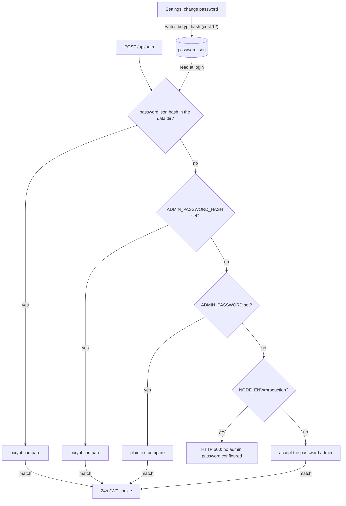

# Configuration

Environment variables read by the server (`server.ts` and the Next.js API
routes). See `.env.example` for a copyable template.

```env
# Required (enforced only when NODE_ENV=production; development falls back to insecure defaults)
ADMIN_PASSWORD=             # plaintext, or use ADMIN_PASSWORD_HASH (bcrypt)
JWT_SECRET=                 # random 32+ char string

# Optional
AGENT_TOKENS=token1,token2  # static tokens (also manageable via Settings UI)
AGENT_TTL_MS=300000         # offline-agent TTL in ms (default 5min)
NEXT_PUBLIC_DEFAULT_GATEWAY_URL=http://localhost:9500
DEFAULT_GATEWAY_TOKEN=      # default OpenClaw API token
ALLOWED_GATEWAY_HOSTS=      # SSRF allowlist for per-instance gateway overrides (comma-separated hostnames, each optionally host:port)
CLAWD_DIR=/root/.openclaw/workspace  # server-local OpenClaw workspace: Memory Viewer fallback (MEMORY.md / CURRENT.md / memory/*.md) and Alert History source (memory/smart-alert-state.json); code default when unset is /root/clawd
CLAWD_MONITOR_DATA_DIR=/data   # persistent storage for tokens + password hash
DOMAIN=monitor.yourdomain.com  # read by docker-compose.traefik.yml only, not by the server
GITHUB_TOKEN=               # GitHub API token for the GitHub PRs widget (read-only; repo/PR and checks read scope)
GITHUB_REPOS=owner/repo,owner/other  # repositories the GitHub PRs widget lists; empty means the widget shows a hint
SERVICE_HEALTH_URLS=api=https://api.example.com/health,https://example.com  # Service Health widget targets, comma-separated `[name=]url`; empty means no checks
PORT=3000                   # listen port (server.ts default)
HOSTNAME=0.0.0.0            # listen address (server.ts default)
```

When running outside Docker (`npm run dev`, `npm start`), the custom server
loads `.env` and `.env.local` (and the mode-specific variants Next.js knows)
into the process environment before it reads any configuration, so a value
set only in `.env.local` reaches the agent WebSocket handler, the token
routes and the production startup check. A variable that is already in the
process environment (the shell, or Docker Compose) keeps its value over
these files. One caveat: when a key is set in both the process environment
and a `.env` file, the process value is kept, but `@next/env` expands a `$`
in it (`dotenv-expand`), so `pa$word` becomes `pa`. Escape it as `\$` or set
the key in one place only. For `NODE_ENV=production npm start` set
`JWT_SECRET` and
`ADMIN_PASSWORD` or `ADMIN_PASSWORD_HASH`. `npm start` does not set
`NODE_ENV`; without `NODE_ENV=production` the server skips the startup check
and accepts the development fallbacks.

Notes:

- `ADMIN_PASSWORD` is compared as plaintext. Set `ADMIN_PASSWORD_HASH` instead
  (a bcrypt hash) if you prefer not to store the plaintext password in the
  environment; use the matching plaintext password to log in. Generate the
  hash in the repository after `npm install`:
  `node -e "require('bcryptjs').hash('yourpassword',10).then(console.log)"`.
  In files read by Docker Compose, write each `$` of the hash as `$$` (see
  [Docker Compose env files](#docker-compose-env-files)).
- After the first login, use `Settings` in the UI to change the admin
  password; that change is persisted in `CLAWD_MONITOR_DATA_DIR` and becomes
  the active login password (it takes precedence over the env var on
  subsequent logins).
- `ALLOWED_GATEWAY_HOSTS` overrides must be `https` and may not point at
  private or loopback IPs; leave it empty to forbid all per-instance
  overrides and use only the default gateway. Rules for an override:
  - **Port.** An entry is a host name, optionally followed by `:port`
    (`gw.example.com:8443`; IPv6 as `[2606:4700::1111]:8443`). An entry without
    a port allows port 443 only. An entry with a port allows only that port, so
    a gateway on 443 and one on 8443 need two entries. A request to any other
    port of an allowlisted host is rejected, and an entry with a port that is
    not 1-65535 is ignored. Write an entry in the serialised form of the host
    that appears in the URL (case is ignored): punycode for international
    names and compressed lower-case IPv6 (`[2606:4700::1111]`, not
    `[2606:4700:0:0:0:0:0:1111]`); an entry in another spelling never matches.
  - **Resolved address.** The host name is resolved when the request connects.
    If any address it resolves to is not public, the request is rejected.
    Not public are loopback, private, link-local, carrier-grade NAT
    (`100.64.0.0/10`), unspecified, multicast, reserved, benchmarking
    (`198.18.0.0/15`), documentation (`192.0.2.0/24`, `198.51.100.0/24`,
    `203.0.113.0/24`) and 6to4 relay (`192.88.99.0/24`) IPv4 addresses; every
    IPv6 address outside the global unicast range `2000::/3` (so the
    IPv4-compatible range `::/96` is never public); and inside it all of
    `2001::/23` except the globally reachable blocks `2001:1::1` to
    `2001:1::3`, `2001:3::/32`, `2001:4:112::/48`, `2001:20::/28` and
    `2001:30::/28`, plus documentation (`2001:db8::/32`, `3fff::/20`). An IPv6
    address that carries an IPv4 address (IPv4-mapped, NAT64 `64:ff9b::/96`
    and 6to4 `2002::/16`) is judged by that IPv4 address. The
    connection goes to exactly the addresses that were checked, so a DNS answer
    that changes between the check and the connect has no effect. TLS still
    verifies the certificate against the host name. A redirect answer is never
    followed. An allowlisted name that points at a private address (an
    internal gateway reached by name, for example) no longer works.
  - **Time limits.** For an override, connecting (lookup, TCP and TLS) must
    finish within 10 seconds and the response headers must arrive within 300
    seconds of sending the request; otherwise the request fails. While the
    body is being read, the gateway must not stay silent for more than 300
    seconds, or the read fails. When nobody reads the body and its buffer is
    full, the limit pauses, so a route that does not read a non-OK answer
    cancels its body, which releases the connection at once.
  - **Agent-reported URLs.** The same rule applies to the `gatewayUrl` a
    connected agent reports: the Log Tail widget fetches it only when it is
    `https`, its host and port are in the list and it resolves to public
    addresses, otherwise it shows that log streaming is not available. That
    includes a URL equal to the default gateway URL: the default's exemption
    does not apply to agent-reported URLs.
  The operator default (`NEXT_PUBLIC_DEFAULT_GATEWAY_URL`) is trusted as
  configured, including `http` and a loopback address.
- With an agent selected, the Log Tail widget's Docker source is not
  available: `/api/agents/<id>/logs?source=docker` answers two "not
  available" lines and never starts `docker` on the clawd-monitor host. Clear
  the agent selection to tail containers on the clawd-monitor host. The log
  routes accept only the sources `openclaw`, `docker` and `system` (otherwise
  400).
- `GITHUB_TOKEN` and `GITHUB_REPOS` are read from the server environment only;
  the GitHub PRs route ignores a `token` or `repos` query parameter.
- Agent tokens can also be issued and revoked from the Settings UI instead of
  the static `AGENT_TOKENS` list.

## Admin password resolution

Login (`POST /api/auth`) checks one source, in this order, and uses the first
one that is set:

1. The bcrypt hash in `password.json` under `CLAWD_MONITOR_DATA_DIR`, written
   when the password is changed in Settings (bcrypt cost 12).
2. `ADMIN_PASSWORD_HASH` (bcrypt compare). If both env vars are set, the hash
   wins.
3. `ADMIN_PASSWORD` (plaintext compare).
4. None set: login returns HTTP 500 when `NODE_ENV=production`; in development
   the password `admin` is accepted.

A successful login sets a session cookie holding a JWT that is valid for 24
hours. The flowchart shows the same order and where a Settings change is
stored.



## Docker Compose env files

- Both compose files read `.env` and then `.env.runtime`; both are optional.
  `.env.runtime` (template `.env.runtime.example`, gitignored) is the place
  for secrets such as `ADMIN_PASSWORD_HASH` and `JWT_SECRET`. `.env` is also
  used for `${DOMAIN}` in `docker-compose.traefik.yml`.
- In these files, write every `$` in a value as `$$`. A bcrypt hash contains
  `$` characters (example in `.env.runtime.example`).
- `NODE_ENV` and `CLAWD_MONITOR_DATA_DIR` are fixed in the compose files
  (`production`, `/data`) and cannot be changed from the env files.

## Troubleshooting

- **Login does not stick:** the session cookie is marked Secure when
  `NODE_ENV=production`, so over plain HTTP it works only on `localhost`. Use
  HTTPS (for example the Traefik setup in the README) for access from other
  machines.
- **Lost admin password:** delete `password.json` from the data directory
  (`CLAWD_MONITOR_DATA_DIR`, the data volume under Docker Compose); the env
  password applies again on the next login.
- **Docker widget or docker log source empty without an agent:** only
  `docker-compose.traefik.yml` mounts the Docker socket; `docker-compose.yml`
  does not.
- **Switching compose files:** `docker-compose.yml` uses the external volume
  `clawd_monitor_data`, while `docker-compose.traefik.yml` creates a
  project-scoped volume, so tokens and the stored password do not carry over.
  The two declarations differ on purpose and are not aligned: changing the
  volume of an existing deployment points the container at an empty volume,
  so it needs a data migration (copy the contents of the old volume into the
  new one) planned first.
